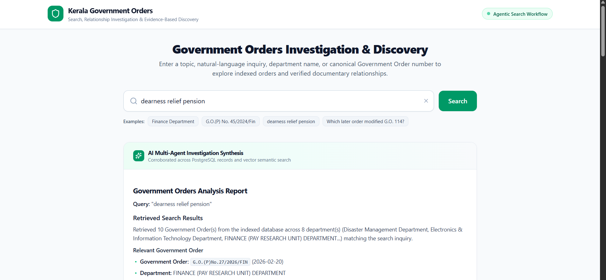
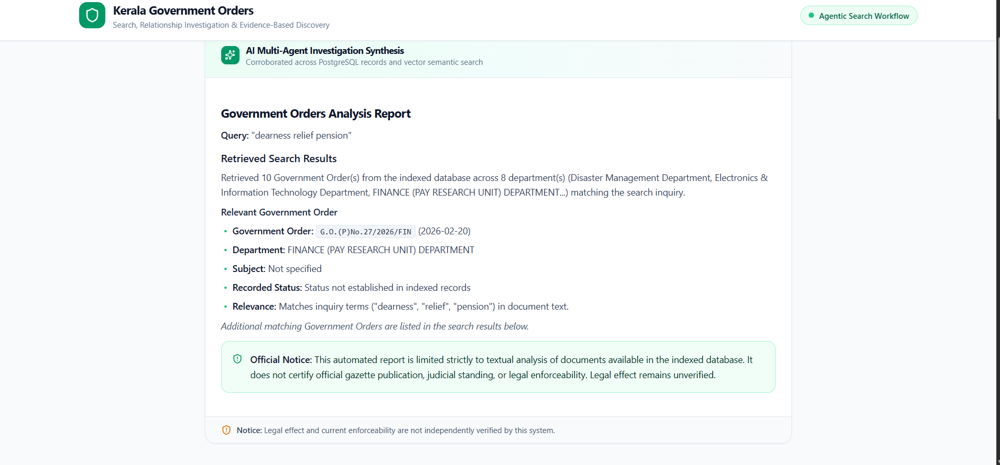
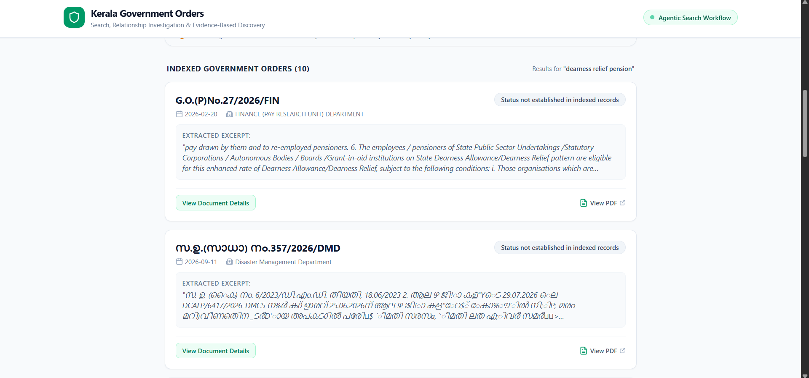
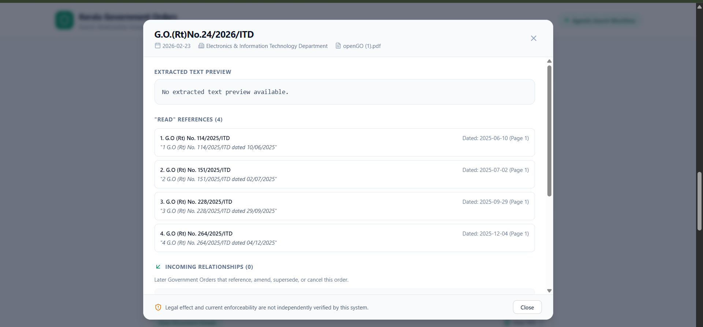
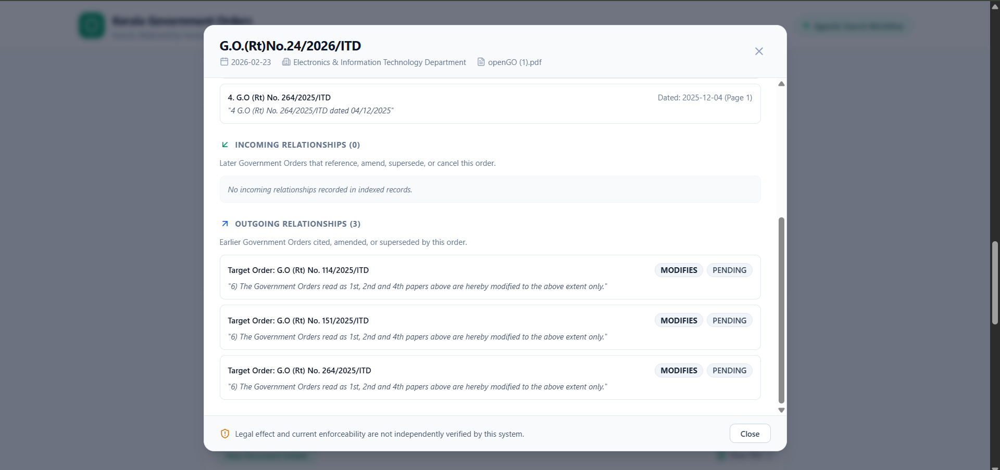
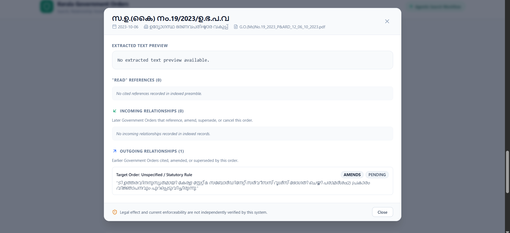
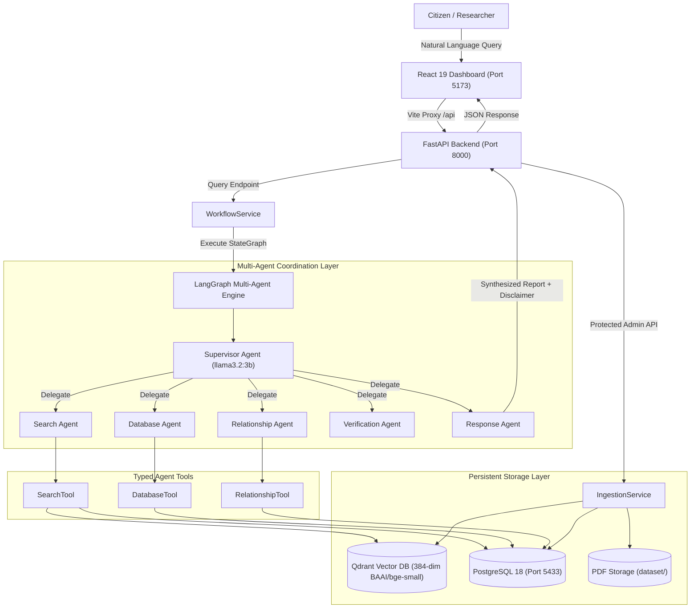
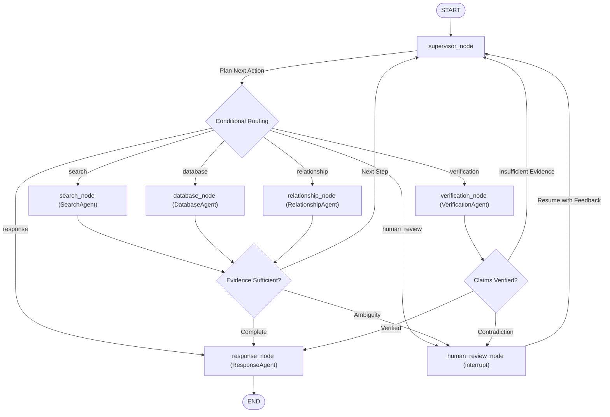

# Kerala Government Orders: Agentic Information Retrieval, Legal Relationship Tracing, and Verification System

An Agentic AI and Full-Stack Information Retrieval platform designed to ingest, extract, index, search, and trace the inter-document legal relationships of official Government Orders (GOs) issued by the Government of Kerala.

---

## 1. Abstract

Official Government Orders (GOs) issued by state departments (Finance, Information Technology, General Administration, Personnel) establish binding administrative rules, pay revisions, service conditions, and statutory amendments. Discovering relevant orders, understanding sequential amendments, and determining whether an earlier notification has been modified or superseded poses a major challenge for citizens, civil servants, and legal researchers.

This project presents a locally hosted, privacy-preserving information retrieval and multi-agent reasoning architecture for official Government Orders. The platform integrates:
1. **Bilingual Document Ingestion**: Text extraction and OCR processing for English and Malayalam PDF orders using PyMuPDF and Tesseract OCR.
2. **Relational Entity Linking**: Directional graph mapping in PostgreSQL, capturing citations, numbered references, and operative modification phrases (*"supersedes"*, *"modifies"*, *"reads with"*).
3. **Dense Vector Semantic Search**: Semantic retrieval in Qdrant using 384-dimensional embeddings generated by `BAAI/bge-small-en-v1.5`.
4. **LangGraph Multi-Agent Orchestration**: Autonomous query decomposition, planning, tool-assisted retrieval, fact verification, and report synthesis powered by a local Large Language Model (Ollama `llama3.2:3b`).
5. **Interactive Citizen Dashboard**: A responsive single-page application built with React 19, TypeScript, and Tailwind CSS for natural-language search, relationship inspection, and inline PDF viewing.

The system is hosted entirely on local compute (Docker PostgreSQL, local embedded Qdrant, local Ollama), avoiding reliance on third-party cloud LLM APIs, keeping query processing within the local network environment, and eliminating external API subscription fees. To ensure legal compliance, all outputs strictly enforce the architectural invariant `legal_effect_verified=False` alongside a mandatory statutory disclaimer.

---

## 2. Problem Statement and Objectives

### Problem Statement
Navigating published state government notifications introduces several domain-specific challenges:
- **Unstructured Bilingual Formats**: Government Orders are published as digital or scanned PDFs with varied layouts and bilingual (English/Malayalam) text, requiring automated classification and OCR fallback.
- **Temporal Amendment Chains**: Orders frequently amend, supersede, or cancel prior notifications across decades. Keyword search alone cannot determine whether a retrieved order remains in force.
- **Vocabulary Mismatch**: Citizen queries typically use natural language (e.g., *"dearness relief pension revision allowances"*) rather than exact bureaucratic identifiers (e.g., `G.O.(P) No. 27/2026/FIN`), causing exact-match SQL queries to fail.
- **Directional Relationship Ambiguity**: Modification dependencies are directional: if Order *B* amends Order *A*, *B* has an *outgoing* modification to *A*, while *A* possesses an *incoming* amendment from *B*. Confusing citation direction leads to incorrect relationship mapping, while determining binding legal standing still requires official gazette verification.
- **Hallucination Risks in Legal Retrieval**: Standard generative LLMs risk fabricating order identifiers, dates, and operative text unless strictly constrained by source-grounded evidence verification.

### Objectives
- Build an automated ingestion pipeline that classifies documents, extracts bilingual text, and parses canonical metadata.
- Model inter-order citations and operative modifications within a normalized PostgreSQL relational schema.
- Implement hybrid retrieval combining dense vector semantic search in Qdrant with sparse keyword search in PostgreSQL via Reciprocal Rank Fusion (RRF).
- Develop a multi-agent workflow in LangGraph with a Supervisor Agent for autonomous planning, tool delegation, evidence verification, and Human-in-the-Loop clarification.
- Deploy an intuitive web dashboard for citizen search and relationship exploration, backed by protected administrative APIs for document ingestion.

---

## 3. Key Features

- **Six Supported Query Intents**: Supports `KEYWORD_SEARCH`, `GO_LOOKUP`, `INCOMING_RELATIONSHIPS`, `OUTGOING_RELATIONSHIPS`, `EXPLAIN_ORDER`, and `AMBIGUOUS_CLARIFICATION`.
- **Hybrid Retrieval with RRF Ranking**: Fuses dense vector semantic similarity with exact database keyword matching via Reciprocal Rank Fusion (*k* = 60) in `SearchAgent`.
- **Directional Relationship Resolution**: Authoritative resolution separating incoming from outgoing relationships, complete with rule-based confidence scoring (`HIGH`, `MEDIUM`, `LOW`).
- **Evidence-Grounded Claim Verification**: Cross-checks synthesized statements against retrieved document chunks to reduce unsupported or ungrounded responses through evidence-based verification.
- **Protected Administrative Ingestion API**: Secure REST endpoints supporting chunked PDF streaming up to 25 MB, `%PDF-` header validation, and constant-time API key verification (`X-Admin-API-Key`).
- **Privacy-Preserving Local Infrastructure**: Operates on local hardware using Docker PostgreSQL, embedded Qdrant, and local Ollama, avoiding reliance on external cloud inference APIs.

---

---

## 4. Dashboard Screenshots

The following screenshots showcase the citizen-facing dashboard and its key functionalities, including natural-language Government Order search, AI-assisted investigation, document retrieval, and directional relationship tracing.

### 1. Government Order Search Results

The dashboard allows users to search for Government Orders using natural-language queries. This example demonstrates a search for "dearness relief pension" and displays the investigation results generated by the system.



### 2. AI Multi-Agent Analysis

Displays the AI-generated investigation report produced by the LangGraph multi-agent workflow. The analysis presents the search summary, relevant Government Order information, supporting findings, and a legal disclaimer clarifying that legal effect and enforceability are not independently verified.



### 3. Retrieved Government Orders

Displays the Government Orders retrieved for the search query, including their GO numbers, issue dates, departments, relevant text excerpts, recorded status, and options to inspect document details or view the original PDF.



### 4. Read References

Displays the Government Orders identified as references within the selected document. The example shows four read references, with their GO numbers, reference dates, and page information.



### 5. Outgoing Relationships – Modifies

Shows outgoing relationships classified as **MODIFIES**, identifying three referenced Government Orders associated with modifications made by the selected order. The displayed relationships have a pending status.



### 6. Outgoing Relationships – Amends

Shows an outgoing relationship classified as **AMENDS**, identifying a reference to an unspecified statutory rule. The displayed relationship has a pending status.


## 5. System Architecture



---

## 6. Agentic AI Workflow

The multi-agent workflow is implemented as a LangGraph `StateGraph` governed by the `SupervisorAgent`:



### Specialized Agents Summary

| Agent | Responsibility | Primary Tools / Methods | Fallback Mechanism |
|:---|:---|:---|:---|
| **SupervisorAgent** | Intent classification, dynamic execution planning, evidence evaluation, and replanning. | `LLMService` (Ollama `llama3.2:3b`) | Rule-based deterministic heuristic planner on LLM timeout or parsing failure. |
| **SearchAgent** | Multi-modal retrieval combining vector similarity and SQL keyword search with Reciprocal Rank Fusion (RRF). | `SearchTool`, `QdrantTool` | Graceful fallback to single retrieval mode if one fails. |
| **DatabaseAgent** | Exact and partial SQL queries on document metadata, citations, and reference records. | `DatabaseTool` (PostgreSQL) | Case-insensitive pattern matching; returns empty structured response on missing order. |
| **RelationshipAgent** | Directional relationship analysis across four modes: incoming, outgoing, bidirectional, and citation chains. | `RelationshipTool` (`GORelationshipDB`) | Distinguishes operative modifications from general historical references. |
| **VerificationAgent** | Corroborates claims against retrieved document text chunks to identify unsupported statements and verify factual grounding. | Internal verification engine | Marks unconfirmed statements as candidate/unverified; enforces `legal_effect_verified=False`. |
| **ResponseAgent** | Synthesizes verified findings into a Markdown report, prioritizing top relevant orders and attaching the legal disclaimer. | Internal templating engine | Prioritizes top 1–2 genuinely relevant orders; embeds verbatim statutory notice. |
| **Human Review Node** | Suspends execution via LangGraph `interrupt()` for ambiguous queries, enabling thread resumption with feedback. | Thread checkpointer (`MemorySaver`) | Resumes execution via `POST /api/v1/resume` (backend capability). |

> [!NOTE]
> **Checkpointing Architecture**: State persistence is handled by `MemorySaver` from `langgraph-checkpoint` in volatile server process RAM (`is_persisted_across_restarts: False`). Paused threads can be inspected and resumed while the server process is active, but do not survive server restarts.

---

## 7. Technology Stack

| Component | Technology | Version | Role in Project |
|:---|:---|:---:|:---|
| **Runtime** | Python | 3.12+ | Core backend runtime and agent framework |
| **API Framework** | FastAPI | 0.162.5 | Asynchronous REST API framework |
| **ASGI Server** | Uvicorn | 0.54.0 | High-performance ASGI web server |
| **Validation** | Pydantic | 2.14.3 | Strict request/response schema validation |
| **Agent Framework** | LangGraph | 1.2.21 | StateGraph multi-agent coordination |
| **Checkpointer** | langgraph-checkpoint (MemorySaver) | 4.3.1 | In-memory checkpointing for thread resumption |
| **Local LLM Engine** | Ollama | `llama3.2:3b` | Local prompt generation and structured JSON planning |
| **Database** | PostgreSQL | 18 (Docker) | Relational storage for orders, references, and relationships |
| **ORM** | SQLAlchemy | 2.1.8 | Database connection pooling and ORM queries |
| **Vector Database** | Qdrant Client | 1.20.0 | Embedded local persistent vector storage on disk |
| **Embeddings** | FastEmbed / BAAI | `BAAI/bge-small-en-v1.5` | 384-dimensional dense semantic text embeddings |
| **PDF Extraction** | PyMuPDF (fitz) | 2.1 | Digital PDF text extraction and layout inspection |
| **OCR Engine** | Tesseract OCR | 5.x / pytesseract 0.3.13 | Bilingual OCR for scanned PDF pages (`eng+mal`) |
| **Frontend Framework**| React | ^19.3.1 | Single-page citizen search dashboard |
| **Frontend Language** | TypeScript | ~7.0.2 | End-to-end frontend type safety |
| **Build Tool** | Vite | ^8.3.6 | Frontend development server and asset bundler |
| **UI Styling** | Tailwind CSS / Lucide React | ^4.3.5 / ^1.75.0 | Utility-first responsive styling and icons |

---

## 8. Project Structure

```
D:\GovernmentOrders
├── docker-compose.yml               # PostgreSQL 18 container configuration (port 5433)
├── requirements.txt                 # Master Python dependencies specification
├── README.md                        # Master project documentation
├── dataset/                         # Storage directory for Government Order PDFs
├── scripts/
│   └── index_qdrant.py              # Offline batch indexing script for Qdrant
├── storage/
│   ├── extracted/                   # Cleaned extracted text files (*.txt)
│   └── qdrant/                      # Persistent local Qdrant collection files
├── app/
│   ├── config.py                    # Global path constants, OCR and Qdrant settings
│   ├── agents/
│   │   ├── state.py                 # LangGraph AgentState TypedDict definition
│   │   ├── llm/                     # Ollama client and structured JSON service
│   │   ├── specialized/             # Supervisor, Search, Database, Rel, Verif, Response agents
│   │   ├── tools/                   # Typed tool adapters (search, database, qdrant, relationship)
│   │   └── workflow/                # LangGraph StateGraph builder and node implementations
│   ├── api/
│   │   ├── auth.py                  # Admin API key authentication dependency
│   │   ├── main.py                  # FastAPI application entry point, CORS, and lifespan
│   │   ├── routes.py                # Public and administrative API routes
│   │   ├── schemas.py               # Pydantic request and response models
│   │   └── service.py               # WorkflowService business logic layer
│   ├── database/
│   │   ├── connection.py            # PostgreSQL engine and session factory
│   │   └── models.py                # SQLAlchemy relational models
│   ├── models/
│   │   └── identifier_extraction.py # Dataclasses for parsed Government Order entities
│   └── services/
│       ├── chunking_service.py      # Semantic paragraph chunking
│       ├── database_service.py      # PostgreSQL persistence service
│       ├── embedding_service.py     # FastEmbed dense vector embeddings
│       ├── identifier_extraction_service.py # Regex entity extraction (GO numbers, dates)
│       ├── ingestion_service.py     # PDF-to-DB-to-Qdrant ingestion pipeline
│       ├── metadata_extraction_service.py   # Department and metadata extraction
│       ├── pdf_classifier.py        # Scanned vs digital PDF classification
│       ├── pdf_service.py           # PyMuPDF and Tesseract OCR text extraction
│       ├── qdrant_service.py        # Qdrant client, collections, and vector search
│       ├── relationship_extraction_service.py # Legal relationship extraction
│       ├── relationship_resolution.py# Bidirectional relationship resolver
│       └── search_service.py        # PostgreSQL keyword search service
├── frontend/
│   ├── index.html                   # HTML entry point
│   ├── package.json                 # Node.js dependencies and scripts
│   ├── vite.config.ts               # Vite configuration with /api backend proxy
│   ├── tsconfig.json                # TypeScript compiler configuration
│   └── src/
│       ├── App.tsx                  # Main citizen dashboard layout
│       ├── main.tsx                 # React DOM entry point
│       ├── api/                     # Typed API clients (documents.ts, admin.ts, client.ts)
│       ├── components/search/       # SearchBar, ResultCard, DocumentDetailModal, Viewer, Banner
│       └── types/api.ts             # TypeScript interfaces matching backend schemas
└── tests/                           # 22 automated test files (187 test cases)
```

---

## 9. Installation and Setup

### 1. Prerequisites
- **Python**: Python 3.12 (64-bit).
- **Node.js**: Node.js 20.19+ or 22.12+ with `npm` (required for Vite 8).
- **Docker**: Docker Desktop (for running PostgreSQL 18).
- **Ollama**: Local Ollama server with `llama3.2:3b` pulled (`ollama run llama3.2:3b`).
- **Tesseract OCR**:
  - Windows: Installed at `C:\Program Files\Tesseract-OCR\tesseract.exe` with `eng.traineddata` and `mal.traineddata`.
  - Linux: `sudo apt install tesseract-ocr tesseract-ocr-mal`.

### 2. Environment Configuration
Create a `.env` file in the project root:
```env
# PostgreSQL Configuration (Docker container on port 5433)
POSTGRES_DB=government_orders_db
POSTGRES_USER=postgres
POSTGRES_PASSWORD=your_secure_password_here

# Administrative API Authentication
ADMIN_API_KEY=your_admin_secret_api_key_here

# Ollama Configuration
OLLAMA_BASE_URL=http://localhost:11434
OLLAMA_MODEL=llama3.2:3b
```

### 3. Setup Commands (Windows PowerShell)

```powershell
# 1. Clone repository
git clone https://github.com/hlekshmi587-bot/GovernmentOrders.git
cd GovernmentOrders

# 2. Configure Python virtual environment
python -m venv .venv
.venv\Scripts\Activate.ps1
python -m pip install --upgrade pip
pip install -r requirements.txt

# 3. Start PostgreSQL container
docker compose up -d

# 4. Pull and test local Ollama model
ollama run llama3.2:3b

# 5. Install frontend dependencies
cd frontend
npm install
cd ..

# 6. (Optional) Run batch ingestion script for dataset/ PDFs
.venv\Scripts\python.exe scripts/index_qdrant.py
```

### 4. Running the Application

**Terminal 1 — FastAPI Backend**:
```powershell
.venv\Scripts\python.exe -m uvicorn app.api.main:app --host 127.0.0.1 --port 8000 --reload
```
- API Base URL: [http://127.0.0.1:8000](http://127.0.0.1:8000)
- Interactive Swagger Documentation: [http://127.0.0.1:8000/docs](http://127.0.0.1:8000/docs)
- Service Health Check: [http://127.0.0.1:8000/health](http://127.0.0.1:8000/health)

**Terminal 2 — React Frontend**:
```powershell
cd frontend
npm run dev
```
- Citizen Dashboard: [http://127.0.0.1:5173](http://127.0.0.1:5173)
- The Vite development server automatically proxies all `/api` and `/health` requests to port `8000`.

---

## 10. API Overview

The FastAPI backend provides 11 endpoints across public search, agentic workflows, and protected administrative management:

| Method | Endpoint Path | Authentication | Purpose | Request Parameters / Schema |
|:---:|:---|:---:|:---|:---|
| `GET` | `/health` | None | Health check verifying PostgreSQL, Qdrant, and Ollama connectivity. | None |
| `POST` | `/api/v1/query` | None | Submits a natural-language query to the LangGraph multi-agent workflow. | JSON: `QueryRequest(query, thread_id)` |
| `POST` | `/api/v1/resume` | None | Resumes a paused Human-in-the-Loop workflow thread with user feedback. | JSON: `ResumeRequest(thread_id, feedback)` |
| `GET` | `/api/v1/status/{thread_id}` | None | Retrieves thread checkpoint status, step progression, and trace count. | Path: `thread_id` (str) |
| `POST` | `/api/v1/search` | None | Direct hybrid / keyword / semantic search without LLM synthesis. | JSON: `SearchRequest(query, top_k, search_mode)` |
| `GET` | `/api/v1/documents/{go_id}` | None | Retrieves metadata, citations, and PDF availability for a single order. | Path: `go_id` (int) |
| `GET` | `/api/v1/documents/{go_id}/relationships` | None | Retrieves verified incoming and outgoing relationship networks. | Path: `go_id` (int) |
| `GET` | `/api/v1/documents/{go_id}/pdf` | None | Streams original Government Order PDF inline for browser viewing. | Path: `go_id` (int), Query: `download=false` |
| `GET` | `/api/v1/documents/{go_id}/pdf?download=true` | None | Downloads original Government Order PDF as a file attachment. | Path: `go_id` (int), Query: `download=true` |
| `POST` | `/api/v1/admin/documents/upload` | `X-Admin-API-Key` | Ingests, parses, commits, and vector-indexes a new Government Order PDF. | Form-data: `file` (PDF stream, max 25 MB) |
| `POST` | `/api/v1/admin/documents/{go_id}/retry-index` | `X-Admin-API-Key` | Triggers on-demand vector re-indexing for an existing database record. | Path: `go_id` (int) |

> [!IMPORTANT]
> **Interface Clarification**: Document ingestion, re-indexing, and human-in-the-loop thread resumption are implemented as backend REST API endpoints (`POST /api/v1/admin/*` and `POST /api/v1/resume`), supported by client libraries such as `frontend/src/api/admin.ts`. The public web dashboard does not include administrative upload controls or a dedicated human-review interface, and is focused on citizen search, relationship exploration, and document retrieval.

---

## 11. Testing and Evaluation

The repository includes an automated test harness comprising **192 test cases** across **23 test files**:

- **Backend Test Suite (22 test files, 187 test cases)**:
  - *Phase 1 Tests* (`test_phase1_step1.py` to `test_phase1_step3.py`, `test_database_service_helper.py`, `test_ingestion_orchestration.py`): Validates PyMuPDF extraction, Tesseract OCR, regex entity parsing, and database transactions.
  - *Phase 2 Tests* (`test_phase2_step1.py` to `test_phase2_integration.py`, `test_supervisor_agent.py`, `test_agentic_search.py`, `test_topic_search_workflow.py`, `test_relevant_order_summary.py`): Validates embeddings, Qdrant collections, RRF hybrid ranking, specialized agents, Supervisor planning, and verification logic.
  - *Phase 4 Tests* (`test_api.py`, `test_dashboard_routes.py`, `test_admin_api_routes.py`, `test_admin_auth_and_schemas.py`): Validates FastAPI endpoints, Pydantic validation rules, error handling, and administrative authentication.
  - *Phase 5 Tests* (`test_phase5_scenario1_corrections.py`, `test_phase5_scenario2_incoming.py`): Validates end-to-end multi-order retrieval and bidirectional relationship networks.
- **Frontend Test Suite (1 test file, 5 test cases)**:
  - `frontend/src/components/search/__tests__/markdown_normalization.test.js`: Validates Markdown heading normalization, callout rendering, and Windows file path preservation.

### Test Execution Commands

```powershell
# Run backend route and schema test suites (Mocked mode)
.venv\Scripts\python.exe -m unittest tests/test_dashboard_routes.py
.venv\Scripts\python.exe -m unittest tests/test_admin_api_routes.py
.venv\Scripts\python.exe -m unittest tests/test_relevant_order_summary.py

# Run frontend normalization tests
cd frontend
node src/components/search/__tests__/markdown_normalization.test.js

# Run frontend TypeScript type checking and production build
npm run build
cd ..
```

---

## 12. Limitations, References, and Legal Disclaimer

### Technical Limitations
1. **Local Inference Latency**: Ollama generation using `llama3.2:3b` runs entirely on local host hardware. Query response latency is hardware-dependent, governed by host CPU/GPU capabilities, available memory, core allocation, and prompt context size.
2. **Dataset Boundary**: The system's retrieval and relationship analysis is bounded strictly by the Government Orders currently ingested into the local PostgreSQL and Qdrant storage. Notifications outside this collection cannot be retrieved.
3. **OCR Degraded Scan Sensitivity**: Historical photocopies with physical degradation, ink bleed, or skewed Malayalam fonts may yield partial OCR extractions.
4. **Single-Process Qdrant File Lock**: In local embedded mode, Qdrant applies an exclusive file-level lock (`portalocker`) on `storage/qdrant/`. Offline batch indexing scripts (`scripts/index_qdrant.py`) cannot run while the FastAPI server process is active.
5. **In-Memory Checkpoint Volatility**: `MemorySaver` retains paused thread states in process memory (`is_persisted_across_restarts: False`). If the backend process restarts, active paused threads are cleared.

### Official Sources and References
- **GitHub Repository**: [https://github.com/hlekshmi587-bot/GovernmentOrders](https://github.com/hlekshmi587-bot/GovernmentOrders)
- **Government of Kerala Official Web Portal**: [https://kerala.gov.in/](https://kerala.gov.in/)
- **Kerala eOffice GO Search**: [https://eoffice.kerala.gov.in/EofficePortal/gosearch.action](https://eoffice.kerala.gov.in/EofficePortal/gosearch.action)
- **PyMuPDF Documentation**: [https://pymupdf.readthedocs.io/](https://pymupdf.readthedocs.io/)
- **Tesseract OCR Engine**: [https://github.com/tesseract-ocr/tesseract](https://github.com/tesseract-ocr/tesseract)
- **Qdrant Vector Database Documentation**: [https://qdrant.tech/documentation/](https://qdrant.tech/documentation/)
- **LangGraph Multi-Agent Framework Documentation**: [https://langchain-ai.github.io/langgraph/](https://langchain-ai.github.io/langgraph/)

### Statutory Legal Disclaimer
This software is developed strictly for academic, research, and informational purposes. The system assists users in locating official publications and tracing referenced notification chains. It **does not certify the legal validity, gazette authenticity, or standing** of any Government Order, nor does it provide legal advice. All synthesized responses strictly enforce `legal_effect_verified=False`. Users must consult the official Gazette of Kerala or authorized departmental secretariats for legally binding determinations.
